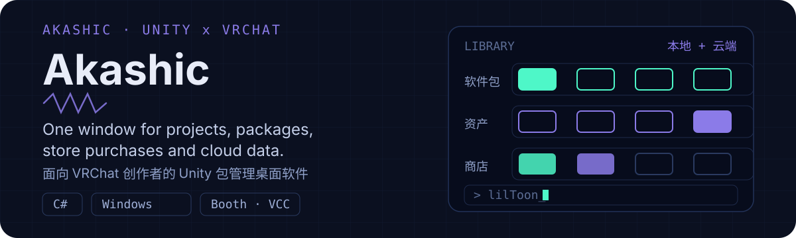

  

# Akashic for VRChat & Unity

面向 VRChat 创作者的 Unity 包管理桌面软件。把散在各处的工程、软件包、商店已购内容和云端数据收进一个窗口，不用反复开 Unity 和文件夹。

**[下载最新 Release](https://github.com/KelierAndes/Akashic-For-VRChat/releases/latest)** · 仅支持 Windows 10 1809+ / Windows 11 · 解压即用，无需 .NET / VC++ 运行时

## 功能亮点

- **工程与软件包**：自动登记本地 Unity 工程；每个工程装了哪些包一目了然（官方 / 社区 / Git / 本地分得清清楚楚）；批量装卸、自动补依赖、缓存秒开。
- **本地资产**：直接读 `.unitypackage`，勾选要的写进工程；卸载精确撤回当初写入的文件，不多删一个。
- **资源目录**：本地包、Booth 已购与 Asset Store 资产统一收录，带封面与分类；「匹配 Booth」自动补全，拿不准时列候选点选，不瞎猜。
- **商店与账号**：软件内直接登录 Booth 与 Asset Store 并下载；已购、礼物、免费领取合并折叠。
- **VRChat 云端**：世界与虚拟形象改名、改可见性直接回写；工程与云端内容双向跳转，断网看缓存。
- **备份与同步**：工程一键备份还原；配置加密存进你自己的 GitHub gist，换机登录即还原。
- **资产预览**：prefab / 模型 / 贴图 / 材质整页浏览；默认实时 3D 秒开，可切 HLSL 精确模式跑真实 Shader（lilToon 等）。

## 快速上手

1. 下载 `Akashic.zip`，**完整解压**到一个文件夹（不要只拖出 exe），双击 `Akashic/akashic_ui.exe`。
2. 首次打开自动扫描常见位置，也可手动「添加项目」或「扫描目录」批量收录。
3. 到 **设置** 确认 Unity 编辑器路径与下载目录；要用商店内容，在对应页登录一次即可。

## 常见问题

| 问题 | 处理 |
| --- | --- |
| 双击没反应 / 窗口空白 | 多半只解压了 exe；连同 `host/`、`data/` 整目录解压后再试 |
| 某个包装了但 Unity 里看不到 | 确认装进 `Packages/` 而非 `Assets/`，重开工程；不行就卸载重装 |
| 预览模型是灰的 | 默认是近似渲染；切「HLSL 精确」看真实 Shader 效果 |
| 检查更新一直失败 | 依次尝试直连、镜像与本机代理；都失败时确认网络可达 GitHub |

更多问题见 [Issue](https://github.com/KelierAndes/Akashic-For-VRChat/issues)；源码、构建与实现细节见 [DEVELOPMENT.md](DEVELOPMENT.md)。
